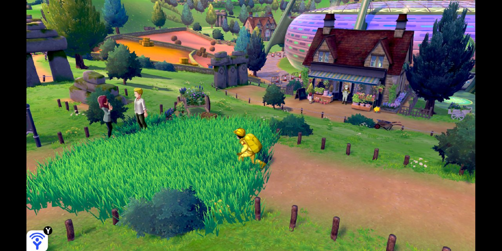
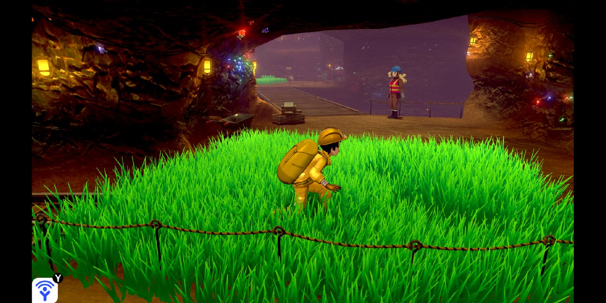
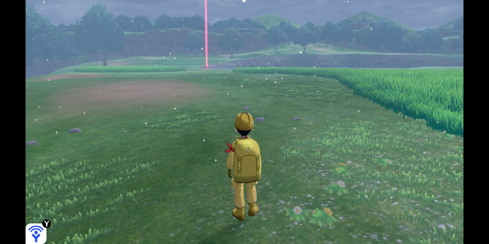
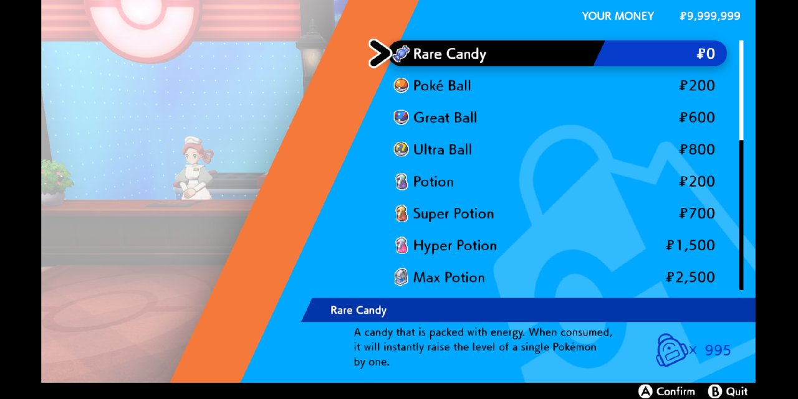
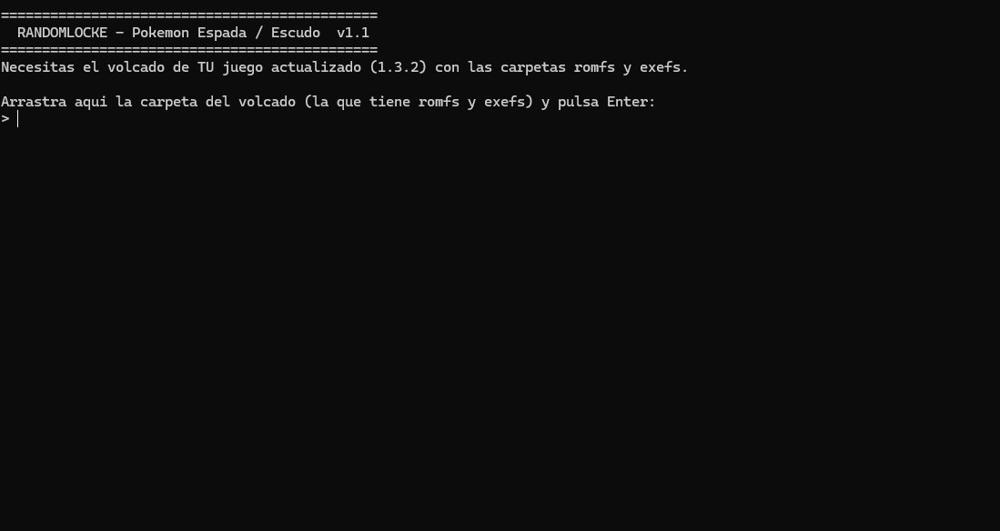

# Randomlocke Espada / Escudo

Randomizador para **Pokémon Espada y Escudo** pensado para la comunidad **randomlocker**.
Genera, a partir de **tu propio volcado del juego**, un mod con todo randomizado y con las reglas
de un randomlocke aplicadas dentro del juego: encuentros que no se ven, sin Repartir Experiencia,
Caramelos Raros gratis, entrenadores más listos y mucho más.

Creado por **@Tukidev** para la comunidad randomlocker.



---

## Índice

1. [Qué cambia en el juego](#qué-cambia-en-el-juego)
2. [Requisitos](#requisitos)
3. [Cómo usarlo paso a paso](#cómo-usarlo-paso-a-paso)
4. [Instalar el mod](#instalar-el-mod)
5. [Partida guardada al 100 %](#partida-guardada-al-100-)
6. [Reglas recomendadas](#reglas-recomendadas)
7. [Limitaciones conocidas](#limitaciones-conocidas)
8. [Compilar desde el código](#compilar-desde-el-código)
9. [Estructura del repositorio](#estructura-del-repositorio)
10. [Créditos y aviso legal](#créditos-y-aviso-legal)

---

## Qué cambia en el juego

### Encuentros: si lo ves, no cuenta

- **No hay Pokémon paseando por el mapa** en todo el juego (rutas, Tierras Salvajes, Isla de la
  Armadura, Tierras Coronadas y agua). Solo hay **encuentros ocultos** (el "!" en la hierba), así que
  no puedes elegir: el primero que sale es el que cuenta.
- **En el agua** no sale nada al surfear; los Pokémon de agua se consiguen **pescando**.
- **Cuevas y zonas sin hierba** (minas de Galar, cuevas de los DLC, Desierto Hondonada, Camino a la
  Cima): tienen **parches de hierba alta** donde aparecían los Pokémon. Solo salen encuentros dentro
  del parche.
- **Ciudades con gimnasio**: cada una tiene un parche de hierba con sus propios Pokémon, en un
  sitio apartado (no en la entrada ni delante del Centro Pokémon).

| Hierba en una ciudad | Hierba en una cueva | Ruta sin Pokémon visibles |
|---|---|---|
|  |  |  |

### Randomización

| Qué | Cómo |
|---|---|
| Pokémon salvajes | Aleatorios y **progresivos**: por debajo de nv. 20 solo formas base (nada de un Garchomp en la Ruta 1); desde nv. 20 también etapas intermedias; desde nv. 25 cualquiera. |
| Entrenadores | Aleatorios y progresivos con la misma regla; **desde nv. 32 solo evoluciones finales**. |
| Iniciales | Aleatorios, distintos entre sí y siempre de **líneas de 3 etapas**. El rival usa la línea que le corresponde. |
| Movimientos | Totalmente aleatorios, con un **10 %** de probabilidad de que sean del tipo del Pokémon. El primero siempre hace daño. |
| Habilidades | Aleatorias (sin Superguarda ni habilidades de cambio de forma, que pueden colgar el juego). |
| Tutores de movimientos | Compatibilidades aleatorias. |
| Objetos y MTs del mapa | Aleatorios (los objetos clave no se tocan). |
| Pokémon estáticos | Aleatorios (salvo combates de historia guionizados). |
| Regalos y eventos | Aleatorios. |
| Intercambios | Te dan un Pokémon aleatorio y piden uno que **sí aparece en estado salvaje** hasta ese nivel. |
| Evoluciones | Las de siempre (Bulbasaur evoluciona en Ivysaur), pero las **evoluciones por intercambio pasan a nivel 30**. |

### Dificultad y reglas dentro del juego

- **IA mejorada en todos los entrenadores**: eligen el ataque que más daño hace (tipos y potencia).
  **No cambian de Pokémon** y solo usan objetos los que ya los usaban.
- **Equipos progresivos** en rivales, líderes, Team Yell, Macrocosmos, Alto Mando y personajes de los
  DLC: 3 Pokémon antes del primer gimnasio, **4 contra el 1.er líder, 5 contra el 2.º y 6 a partir del 3.º**.
- **Repartir Experiencia desactivado**: solo gana experiencia el Pokémon que combate (parche del
  ejecutable).
- **Caramelos Raros a 0 $** en todas las tiendas Pokémon desde el principio.
- **Texto de bienvenida** del mod en la presentación de Rose (solo en español).
- Cada partida genera un **registro con spoilers** (qué sale en cada ruta, cada entrenador importante,
  iniciales, regalos, estáticos e intercambios).



---

## Requisitos

- **Windows 10 u 11 (64 bits)**. No hace falta instalar nada más.
- **Tu propio volcado** de Pokémon Espada o Escudo **con la actualización 1.3.2**, con las carpetas
  `romfs` y `exefs`. Este repositorio **no incluye ni enlaza el juego**.
  - En la mayoría de emuladores: instala la actualización 1.3.2, clic derecho en el juego →
    *Volcar RomFS* / *Extraer datos* y lo mismo con el ExeFS.
  - En Switch con Atmosphère: con NXDumpTool (romfs y exefs con la actualización aplicada).
- Un emulador de Switch o una Switch con Atmosphère para jugar.

> Probado con **Espada 1.3.2**. Escudo está soportado en el programa pero no se ha probado con un volcado real.

---

## Cómo usarlo paso a paso

1. Descarga **`Randomlocke.exe`** (carpeta [`dist/`](dist/) o la sección *Releases*).
2. Ábrelo con doble clic.
   - Si Windows muestra *"Windows protegió su PC"*, pulsa **Más información → Ejecutar de todas formas**
     (es normal en programas sin firma digital).
3. **Arrastra la carpeta de tu volcado** (la que contiene `romfs` y `exefs`) a la ventana y pulsa Enter.
   También vale arrastrar `romfs` y `exefs` a la vez.
4. Escribe una **semilla** o pulsa Enter para una aleatoria. La misma semilla genera siempre la misma partida.
5. Espera unos segundos. Al terminar verás la ruta de:
   - `Randomlocke_<semilla>`: **el mod**.
   - `Randomlocke_<semilla>_log.txt`: el registro con spoilers.



---

## Instalar el mod

**Emulador** (Eden, yuzu, Citron, Sudachi, Ryujinx...): clic derecho en el juego → *Abrir carpeta de mods*
y copia dentro la carpeta `Randomlocke_<semilla>` completa. Debe quedar así:

```
<carpeta de mods del juego>/Randomlocke_1234/romfs/...
<carpeta de mods del juego>/Randomlocke_1234/exefs/...
```

**Switch con Atmosphère**: copia el **contenido** de `Randomlocke_<semilla>` (las carpetas `romfs` y `exefs`) en:

- Espada: `sd:/atmosphere/contents/0100ABF008968000/`
- Escudo: `sd:/atmosphere/contents/01008DB008C2C000/`

Después: **desactiva cualquier otro mod del juego** y **empieza una partida nueva**.

---

## Partida guardada al 100 %

En [`partida/`](partida/) hay una **partida de Espada completada al 100 %**, para quien quiera curiosear
o probar cosas del mod (combates, zonas avanzadas, cuevas de los DLC...) antes de empezar su aventura.

Para usarla en un emulador: clic derecho en el juego → *Abrir ubicación de datos guardados*, haz una
**copia de seguridad de tu partida** y sustituye el archivo `main` por el de esta carpeta.

> Los Pokémon que ya están en el equipo o en las cajas no cambian con el mod; lo randomizado se ve en
> los encuentros, entrenadores y demás.

---

## Reglas recomendadas

El mod ya aplica dentro del juego la mayoría de reglas típicas. Para el resto se recomienda:

- **Primer encuentro**: solo puedes capturar el primer Pokémon que te salga en cada zona.
- **Muerte**: si un Pokémon se debilita, se libera o va a una caja de "cementerio".
- **Level cap**: no superar el nivel del Pokémon más fuerte del siguiente líder (usa los Caramelos Raros con cabeza).
- **Prohibido**: incursiones Dinamax (se ve qué Pokémon hay en cada guarida), objetos curativos en combate
  (opcional) y Campamento para ganar experiencia.
- **Tierras Salvajes**: cada subzona cuenta como una zona.

---

## Limitaciones conocidas

- Los **intercambios** del juego exigen una especie concreta (no se puede dar "cualquiera"), por eso piden
  un Pokémon que se pueda atrapar.
- **No se randomizan** algunos combates de historia guionizados (Eternatus, Zacian/Zamazenta, Calyrex) ni
  Kubfu, porque podrían bloquear la historia.
- Las **incursiones Dinamax** no se tocan.
- El texto de bienvenida solo está en español; en otros idiomas sale el discurso original.
- La Cueva Rompeolas y la Cueva Dínamo no tienen pesca, así que sus Pokémon de surf no están disponibles.

¿Algo raro o un crash? Abre un *issue* indicando la **semilla** y adjuntando el **registro** (`_log.txt`).

---

## Compilar desde el código

El programa está escrito en **Go** y no tiene dependencias externas.

```bat
cd src
build.bat          :: Windows
```
```sh
cd src && ./build.sh   # Linux / macOS (genera también la versión de Linux)
```

Necesitas [Go 1.22 o superior](https://go.dev/dl/). El ejecutable queda en `dist/`.

---

## Estructura del repositorio

```
dist/              Randomlocke.exe listo para usar
src/               Código del randomizador (Go)
  main.go            Flujo principal (lectura del volcado, pasos, escritura del mod)
  core.go            LZ4, contenedores GFPack y lectura/escritura de FlatBuffers
  data.go            Especies, evoluciones, movimientos, textos y selección progresiva
  personal.go        Movimientos, habilidades y tutores
  wild.go            Pokémon salvajes, tablas ocultas nuevas y Pokémon visibles desactivados
  caves.go           Colisiones, recorte del suelo, matojos de hierba y descriptores de terreno
  cities.go          Hierba en ciudades con gimnasio
  trainers.go        Entrenadores, IA y equipos progresivos
  events.go          Iniciales, regalos, estáticos, intercambios y objetos del mapa
  evos.go            Evoluciones por intercambio -> nivel 30
  shop_exe.go        Caramelos Raros y parche del Repartir Experiencia
  intro.go           Texto de bienvenida
  tables.go          Tablas de zonas y objetos (derivadas de pkNX)
tools/python/      Scripts de investigación en Python usados durante el desarrollo
patches/           Parche del Repartir Experiencia (.ips para Espada 1.3.2 y .pchtxt)
partida/           Partida guardada al 100 %
docs/              Notas técnicas e imágenes
```

Las notas técnicas sobre cómo funciona cada cambio están en [`docs/tecnico.md`](docs/tecnico.md).

---

## Créditos y aviso legal

- Creado por **@Tukidev** para la comunidad randomlocker.
- Formatos de archivo y tablas de zonas basados en el trabajo de **[pkNX](https://github.com/kwsch/pkNX)**
  (Kaphotics y colaboradores) y la comunidad de **ProjectPokemon**.
- Pokémon es propiedad de Nintendo, Game Freak y The Pokémon Company. Este proyecto no está afiliado a ellos.
  **No incluye ni distribuye archivos del juego**: cada jugador debe usar el volcado de su propia copia.

Licencia: [GPL-3.0](LICENSE).
